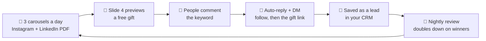

# 🚀 Agentic Business Kit

### Your AI agent runs your marketing and sales.
**It brings in leads, saves them in your CRM and follows up for you, using playbooks proven on a real business.**

**[⚡ Start in 5 minutes](#-start-in-5-minutes)** · **[🎁 What you get](#-what-you-get)** · **[📈 How the marketing engine works](#-how-organic-marketing-works)** · **[🏭 Industries](#-built-for-your-industry)** · **[🔄 Updates](#-staying-up-to-date)**

---

## ⚡ Start in 5 minutes

| Step | What to do |
|:---:|---|
| **1️⃣ Install** | **Claude:** in [Claude](https://claude.ai) open *Customize → Plugins → Add marketplace → Add from a repository*, paste `https://github.com/myappz-ai/agentic-business-kit` and turn on **Agentic Business Kit**. **ChatGPT (Business / Enterprise admins):** in [ChatGPT](https://chatgpt.com) open *Admin → Plugins → Add → Import marketplace* and paste the same link. |
| **2️⃣ Connect** | Connect your business account when your agent asks. You sign in on your account's own page. **Never paste passwords or keys into the chat.** |
| **3️⃣ Say "Get started"** | Your agent checks your account, fills in your business details and tells you your best first step. |

> 💡 You never need to open the files in this repository. Your agent reads them for you.

---

## 🎁 What you get

| Just say | What your agent does for you |
|---|---|
| 🧭 **"Get started"** | Share your website, your company name or a document like a tax certificate. Your agent fills in your business profile, logo and social links, checks every channel (Instagram, WhatsApp, email, calendar, ads) and gives you a link to fix anything missing. |
| 📱 **"Set up organic marketing"** | 3 posts a day on Instagram: 2 carousels (with a PDF copy on LinkedIn) and 1 reel your AI avatar makes by itself (HeyGen, with an optional ElevenLabs voice) (also posted to LinkedIn and YouTube Shorts). Every post offers a free gift. Anyone who comments the keyword gets a DM, follows you, then gets the gift and is saved as a lead. One tracker doc shows every post and its numbers, and every night it learns from them. |
| 🎯 **"Launch lead form ads"** | Facebook and Instagram lead ads that drop leads straight into your CRM, with instant WhatsApp and email replies and a call reminder for your team. Built as drafts; nothing goes live without your "go ahead". |
| 🧩 **"Add this to the Agentic Business Kit"** | When something works for your business, your agent turns it into a playbook. It becomes a shared rule only once real numbers prove it. |

---

## 📈 How Organic Marketing works

<table>
<tr>
<td width="33%" valign="top">

**🗓️ 3 posts, 2 styles**

- **Morning:** your expertise, as clean tips
- **Afternoon:** life lessons in big type, made to be shared
- **Evening:** sales and growth for your customers

</td>
<td width="33%" valign="top">

**🧱 The 10-slide shape**

- **Slide 1:** the hook + "🎁 Free gift on slide 4"
- **Slide 4:** a preview of the free gift
- **Slide 9:** a recap to screenshot
- **Slide 10:** comment, save and share

</td>
<td width="33%" valign="top">

**🔑 Keywords anyone can type**

- One short, everyday word
- Each post sends its own gift, even when a word is reused
- One reply per person, never spam

</td>
</tr>
</table>

**Why this pattern?** On the account it was built on, posts that asked for a comment keyword reached about **3.5× more people** than posts that didn't, and list posts were saved far more often than story posts.

---

## 🏢 For agencies: the same flow for every client

1. Install this kit (and the **Agentic Agency Kit**) on the agency's Claude.
2. For each client, connect **that client's own account**. Or the client installs this kit on their own Claude.
3. Say **"Set up organic marketing"** inside the client's account. Your agent runs the same carousels, reels, guides, DM flows, tracker doc and nightly report for that client.
4. Keep each client's settings (IDs, topics, approvals, avatar and voice) in that client's own private workspace, never in a shared kit. The Agency Kit's `onboard-a-client` shows the layout.

---

## 🏭 Built for your industry

Your agent matches your business to a starting plan, with topics, free gift ideas, keywords and the right next step after the DM. Then it learns your own style from your own numbers.

| | | | |
|---|---|---|---|
| 🎓 Training & coaching | 💼 Consulting | 🏠 Real estate | 🎉 Events |
| 🛡️ Insurance | 🏫 Education | 🩺 Clinics | 💇 Salon & spa |
| 💄 Bridal & beauty | 🏭 Manufacturers | 📦 Distributors | 🛍️ Retail |
| 🛒 E-commerce | ✈️ Travel | 🔮 Occult sciences | 💰 Financial services |
| 🏋️ Fitness | 📐 Architects & interiors | 💻 Software & agencies | |

Every industry plan also lists what never to say, such as cure claims, return guarantees or weight-loss promises.

---

## 🛡️ You stay in control

| ✅ Always | 🚫 Never |
|---|---|
| A clickable link to check everything it builds | Sending to customers or spending money without your OK |
| Real facts from pages it actually opened | Made-up numbers, income promises or fake discounts |
| Your own brand name in front of your customers | Asking for your passwords or one-time codes |
| Your own style saved in your account, so it stays yours | Overwriting your style when the kit updates |

---

## 🔄 Staying up to date

New proven playbooks and improvements are added regularly.
- **Claude:** *Customize → Plugins → Agentic Business Kit → Update*.
- Or just tell your agent: **"Update my Agentic Business Kit."**

**Coming next, once proven:** VSL funnel · live webinar funnel · WhatsApp re-engagement · online shop launch · review campaign.

---

**Running an agency?** Ask about the **Agentic Agency Kit**.

Claude Code: `/plugin install agentic-business-kit --marketplace myappz-ai/agentic-business-kit` · Rules, connections and change log for your agent and team are in <a href="docs/">docs</a>.

